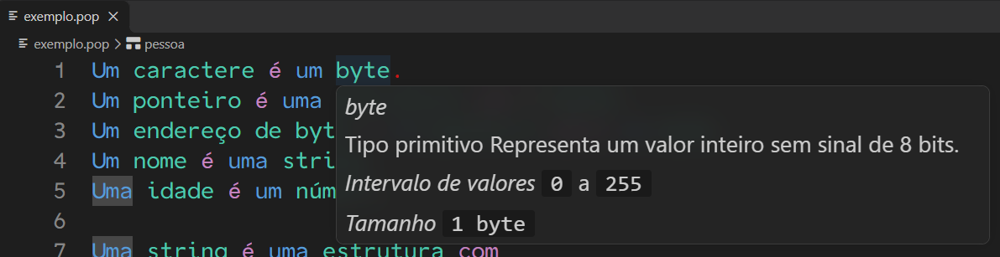
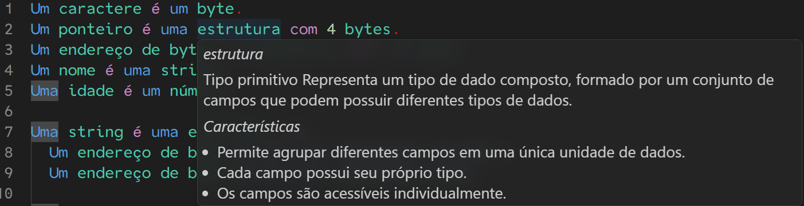
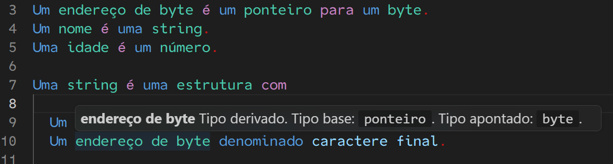
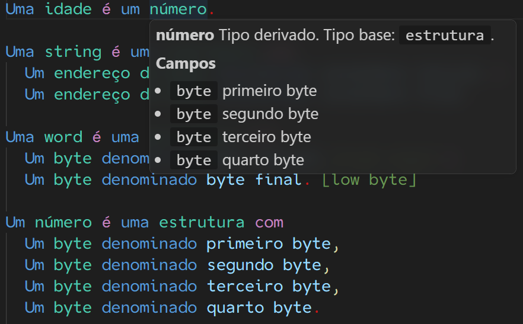
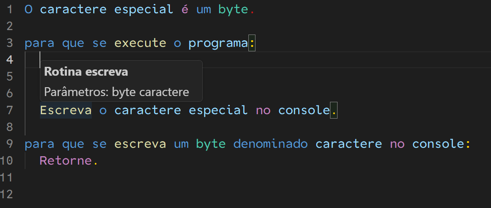
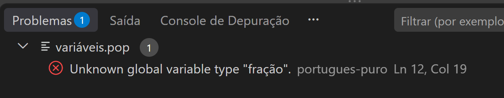
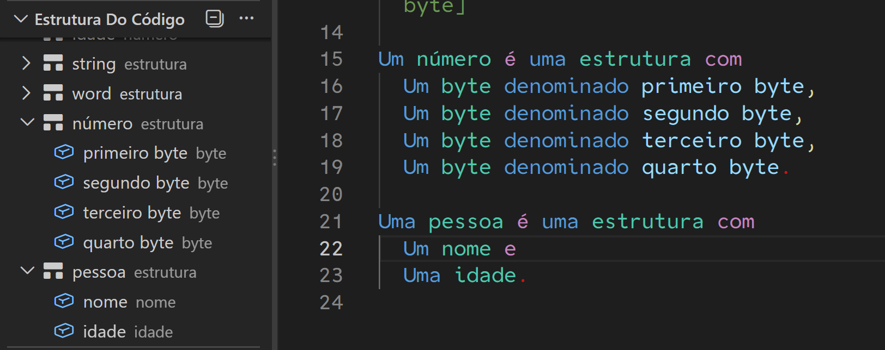

# Português Puro Language Server


[](logo.png)

\<p align="center">
&#x20; \<strong>Complete language support for Português Puro in Visual Studio Code.\</strong>
\</p>

## Description

The Português Puro Language Server extends Visual Studio Code with intelligent language features for the [Português Puro](https://github.com/ElenderG/Portugues-Puro) programming language.

Unlike a simple syntax highlighter, the language server analyzes source code, understands declarations and relationships between symbols, and provides intelligent navigation, diagnostics, symbol search, references, renaming, and automatic formatting.

## Hover  
[](./funcionalidades/hover0.png)
[](./funcionalidades/hover1.png)
[](./funcionalidades/hover2.png)
[](./funcionalidades/hover3.png)
[](./funcionalidades/hover4.png)

## Language diagnostics  
[](./funcionalidades/problemas.png)

## Document symbols  
[](./funcionalidades/estrutura.png)


Português Puro is a general-purpose programming language designed to prioritize readability and comprehensibility. It was created by [Elender Gallas](https://www.linkedin.com/in/elender/) and [Élisson Gallas](https://www.linkedin.com/in/elissongois/).

For more information about the language, visit the [official documentation](https://portugues-puro.gitbook.io/documentacao).

## Features

### Code Navigation

- **Go to Definition** — Navigate to types, routines, variables, and structure fields, including declarations in other files.
- **Find All References** — Find every reference to a symbol throughout the workspace.
- **Rename Symbol** — Rename types, routines, fields, and variables across multiple files.
- **Workspace Symbols** — Search for declarations across workspace folders.

### Code Intelligence

- **Document Symbols** — Browse types, global variables, routines, parameters, local variables, and structure fields.
- **Diagnostics** — Identify syntax errors, unresolved references, invalid declarations, incompatible arguments, and other semantic problems.
- **Semantic Analysis** — Understand type inheritance, pointers, structures, computed fields, and overloaded routines.

### Code Formatting

- Consistent two-space indentation.
- Automatic indentation of structure fields and routine bodies.
- Formatting of conditional and loop blocks.
- Automatic line wrapping for supported expressions.
- Preservation of strings and comments.

### Types and Variables

- Primitive types: byte and estrutura.
- Derived types and type aliases.
- Scalar types with integer multipliers.
- Pointer types and structure declarations.
- Structure fields, including unions, references, and byte arrays.
- Global variables and inferred types from literal initializers.
- Case-insensitive type and identifier resolution.

Example:

```text
Um caractere é um byte.
Uma quantidade é um número.
Uma pessoa é uma estrutura com
    Uma string denominada nome,
    Um número denominado idade.
```

### Routines and Functions

- Routine and function declarations.
- Parameters and return types.
- Alternate routine names.
- Routine overloading.
- Parameter compatibility through type inheritance.
- Local variable declarations and parameter preservation.
- Boolean functions and predicates.

Example:

```text
Rotina para que se apresente uma pessoa
    usando uma pessoa
    retornando uma string:

    Escreva o nome da pessoa para StdOut.
```

### Statements and Expressions

- Conditional statements.
- Loop control with `Itere`, `Pare`, and `Reitere`.
- Early returns.
- Arithmetic and string expressions.
- Null values and pointer operations.
- Structure field access, including chained access.
- Computed structure fields.
- Type operators such as `endereçamento`, `magnitude`, and `conteúdo`.

### Built-in Instructions

The language server recognizes and validates special instructions, including:

- `Decodifique`
- `Empilhe`
- `Aloque memória para`
- `Direcione`, `Aponte`, and `Redirecione`
- `Processe`
- `Retorne`
- `Preserve`
- `Diga`

### Comments and Literals

The parser recognizes:

- Line comments beginning with `\`.
- Block comments delimited by `[ ... ]`.
- Quoted strings with doubled-quote escaping.
- Decimal integers, fractions, mixed numbers, and hexadecimal values.
- Boolean and null literals.

### Language Understanding

- Type declarations and inheritance.
- Structures, unions, pointers, and references.
- Global and local variables.
- Routine and function declarations.
- Routine overloading and parameter resolution.
- Conditional statements and loops.
- Arithmetic and string expressions.
- Built-in instructions and special language constructs.

## Requirements

- Visual Studio Code.
- Português Puro source files (`.pop`).

The extension uses Windows-1252 (`windows1252`) as the default encoding for Português Puro files.

## Installation

Install the extension directly from the Visual Studio Code Marketplace or search for **Português Puro Language Server** in the Extensions view (`Ctrl+Shift+X`).

After installation, open any `.pop` file to activate the language server.

## Related Projects

- [Português Puro](https://github.com/ElenderG/Portugues-Puro) — The programming language, compiler, and documentation.

## Development

To build and test the extension locally:

1. Clone the repository.
2. Install dependencies:

```bash
npm install
```

3. Open the project folder in Visual Studio Code.
4. Press `Ctrl+Shift+B` to compile in watch mode.
5. Press `F5` to launch an Extension Development Host.

Run the test suite with:

```bash
npm test
```

## Related Projects

- [Português Puro](https://github.com/elenderg/Portugues-Puro) — The programming language, compiler, and documentation.

## Support and Feedback

For bug reports, suggestions, or feature requests, visit the [GitHub Issues](https://github.com/ElenderG/Portugues-Puro/issues) page.

## Changelog

See [CHANGELOG.md](CHANGELOG.md) for a history of changes and improvements.